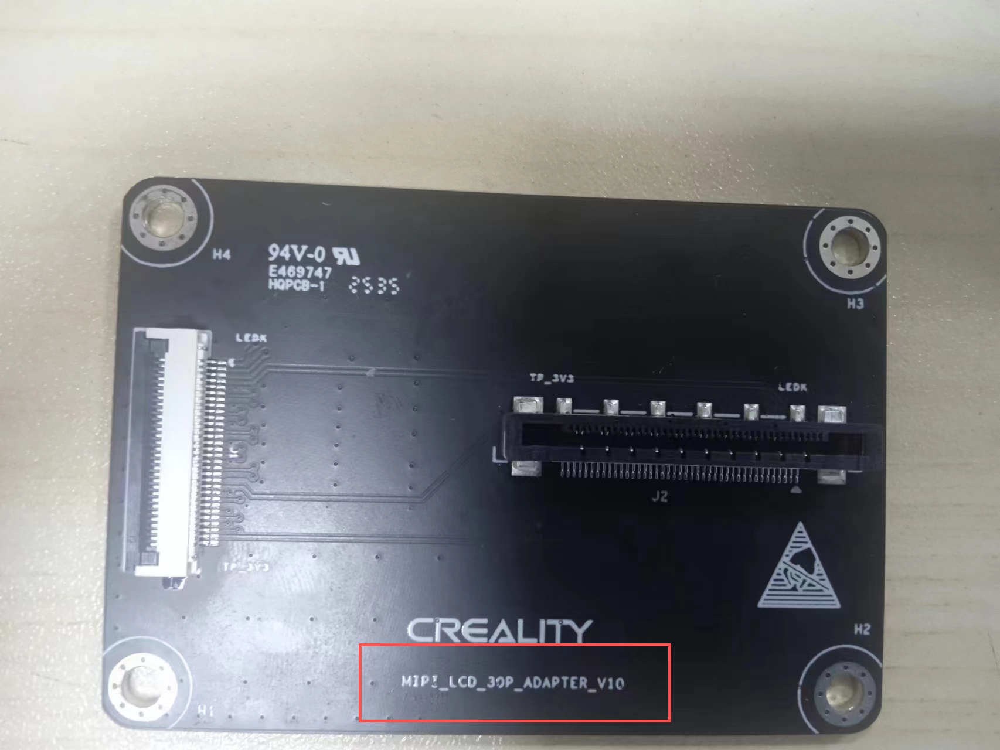

# Introduction
This chapter provides product images of all materials in the kit for MIPI LCDs.

# Operating Conditions
This kit is compatible with certain Creality K1 series models, provided that the factory-installed LCD meets all of the following conditions simultaneously:
- The PCB on the back indicates that the LCD type is MIPI LCD.

  

- The LCD's FPC is yellow and bears the "20222045-2543-0457" label.

  

- The FPC cable specifies a 30-pin signal configuration

  

# Product Images
## Overview

## Catalyst.K-Mainboard

## Catalyst.K-Tool

## Catalyst.K-Level

## Catalyst.K-rLCD

## Catalyst.K-HDMIFPC
