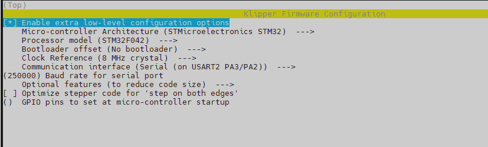
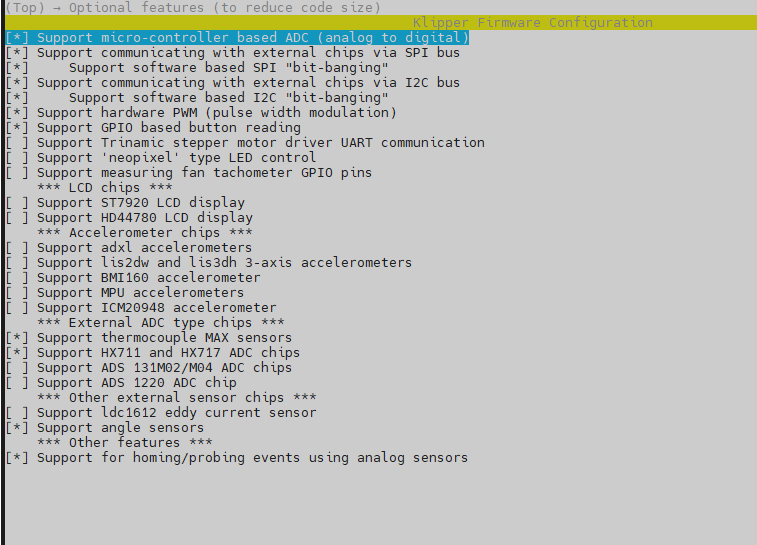

# Catalyst.K-Level

# Introduction
Catalyst.K Leveling is a high-precision leveling control solution designed specifically for 3D printers. Integrating high-precision load cell technology and supporting the Klipper firmware ecosystem, the board achieves superior automatic leveling performance through real-time pressure monitoring, thereby enhancing the quality and stability of the first printed layer.

# Features 
- Main Controller: STM32F042F6P6 (High-performance ARM Cortex-M0 32-bit microcontroller)

- Weighing/Data Acquisition Chip: HX711 (24-bit high-precision A/D converter with built-in voltage regulator)

- Communication Interface: RS-232 standard serial communication

- System Compatibility: Full support for Klipper open-source firmware

- Applications: Automatic bed/nozzle leveling for 3D printers, pressure sensing
# Applications 
- High-Precision Sensing: Equipped with the dedicated HX711 ADC chip, ensuring highly accurate pressure sensing with minimal drift.

- Native Klipper Support: Seamlessly integrates with Klipper systems, utilizing high-speed RS-232 data transmission to meet the demands of high-precision leveling calculations.

- Compact Design: Features a space-efficient layout, making it easy to integrate into various printer configurations.

- Industrial-Grade Control: Powered by a stable STM32 core, ensuring rapid response for leveling operations.


## Firmware Configuration
Catalyst.K LevelingMCU uses the bootloader-free mode by default, and the configuration is as follows:
 
 

## Firmware Upload
Use the following commands to compile and upload the firmware.
```
cd ~/klipper
make flash FLASH_DEVICE=0483:df11
```

## Important
During normal operation, PA0, PA1, PA5, and PA6 should all be at a low logic level; please do not set them to a high logic level.

# PinOut

# Product Link