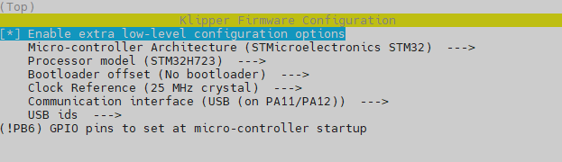
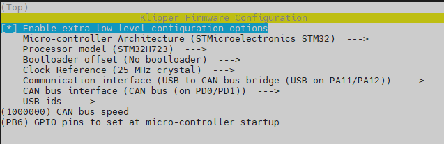
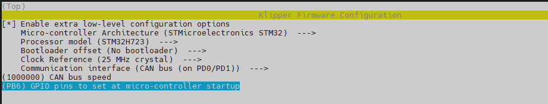
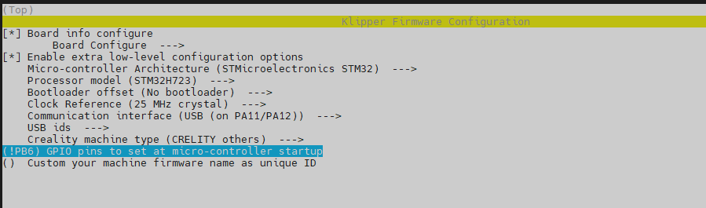
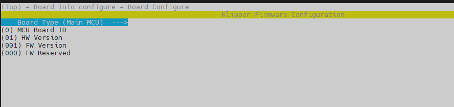
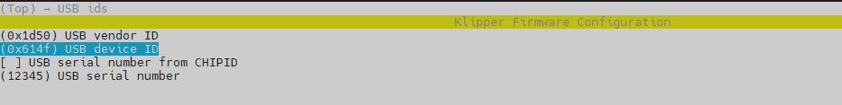
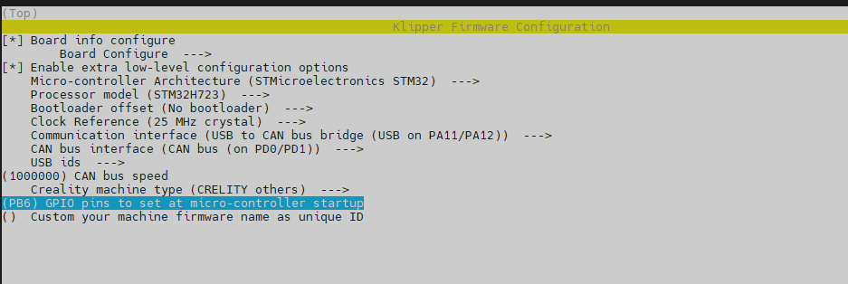
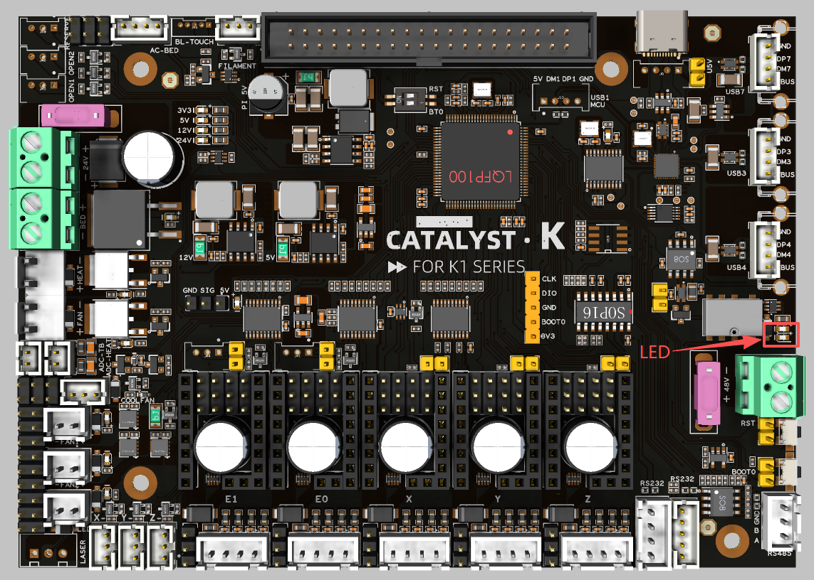
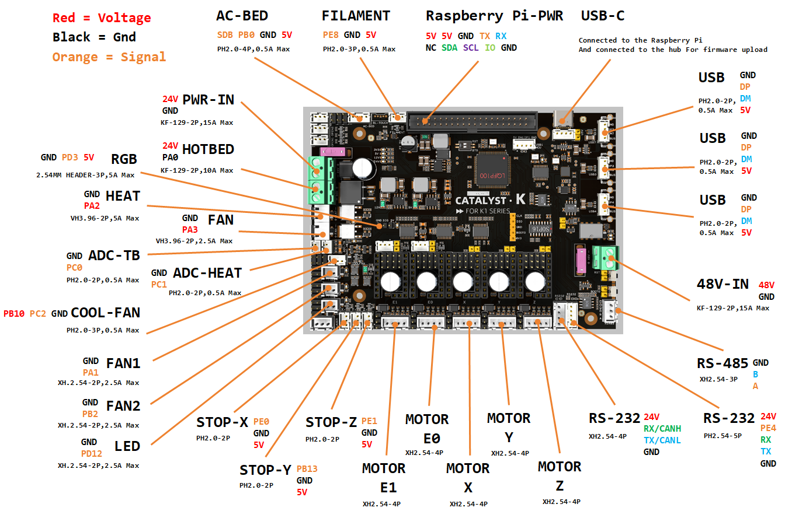

# Catalyst.K-Mainboard


# Introduction
This high‑performance 3D printer mainboard is built around an STM32H723 32‑bit MCU and comes in a 138 mm × 98 mm form factor. Designed for modern open‑source firmware such as Klipper, it connects to external SBCs like Raspberry Pi 3B+/4B/5B via USB to form a powerful “MCU + SBC” architecture, enabling high‑speed printing, multi‑axis motion control, and advanced feature expansion.

# Features
- High‑performance MCU based on STM32H723 for demanding 3D printing workloads such as high‑speed interpolation and synchronized multi‑axis motion control.
- Native support for Klipper‑style setups via USB connection to Raspberry Pi 3B+/4B/5B or any Klipper‑compatible host.
- Five STEPSTICK sockets supporting flexible driver choices such as TMC5160 and TMC2209 to balance torque, smoothness, and silent operation.
- Selectable 24V/48V stepper motor supply with per‑motor voltage selection for mixed‑voltage motion systems.
- DC 24V input with 24V/10 A heated bed output, AC bed control signal output, and up to 5A hotend heater output for high‑power applications.
- On‑board regulated rails: 12V/3A, 5V/3A, 5V/6A (for Raspberry Pi power), and 3.3V/800 mA to power fans, sensors, and SBCs from a single board.
- Rich connectivity including 3× USB, 2× RS‑232, 1× RS‑485, and 1× high‑speed CAN interface for advanced expansions and distributed motion systems.
- Nine general‑purpose IOs and five fan outputs, with four voltage‑selectable (5V/12V/24V), plus an RGB header for status indication and lighting effects.

-------

# Applications
- Ideal as the main controller for mid‑ to high‑end FDM 3D printers, especially Klipper‑based high‑speed and multi‑axis systems.
- Suitable for upgrading existing printers from legacy 8‑bit or low‑performance boards to an STM32H7 + Klipper platform for higher speed and greater flexibility.
- Can be used in other motion‑control equipment requiring up to five stepper axes, 24 V / 48 V mixed supplies, and rich communication interfaces, such as small CNC machines, automation rigs, and laboratory devices.


# Firmware compilation and upload
## Firmware Configuration
### General Klipper
#### Serial and USB
<p align="left">
  
</p>

#### Usb to Can
<p align="left">
  
</p>

#### Can
<p align="left">
  
</p>

### K1_Series_Klipper
#### Serial and USB
<p align="left">
  
</p>

<p align="left">
  
</p>

<p align="left">
  
</p>

#### Usb to Can
<p align="left">
  
</p>

## Firmware Upload
Use the following commands to compile and upload the firmware.
```
cd ~/klipper  # or cd ~/K1_Series_Klipper
make flash FLASH_DEVICE=0483:df11
```

## LED Indications
<p align="left">
  
</p>

When in DFU mode, or after flashing firmware for USB/Serial mode, the green led turns on; after flashing firmware for CAN mode, the red led turns on.

# PinOut


All peripherals are installed in the same positions as on the original motherboard. With the exception of the shared serial and CAN interfaces, the pinout definitions for all other terminals are identical to those of the original motherboard.

# Reference
[Catalyst.K](https://wiki.fysetc.com/docs/JRDhzc53?preview=1)

# Product Link