# Catalyst.K-Tool


# Introduction
Catalyst.K ToolHead is a compact Klipper toolboard with a footprint of only 47 mm × 44 mm, designed to be mounted close to the printhead or extruder. It is powered by an STM32G431CBT6 32‑bit MCU and supports multiple communication modes, including USB and CAN / RS‑232, which can be switched via an on‑board physical button.
The board integrates a TMC2209 stepper motor driver, an ADXL345 3‑axis accelerometer, multiple fan and temperature inputs, as well as BL‑Touch and hotend heater control. This greatly simplifies toolhead wiring, reduces cable bundle weight on moving parts, and improves overall reliability and serviceability of the printer.

# Features 
- Compact toolboard design: 47 mm × 44 mm, mounted directly near the printhead or extruder to greatly simplify wiring.
- STM32G431 MCU: 32‑bit high‑performance controller optimized for Klipper multi‑MCU setups.
- Multiple communication modes: Supports USB, CAN, and RS‑232, switchable via on‑board button.
- On‑board USB hub: Provides 3× USB ports and 1× CAN port for easy host and expansion connectivity.
- Integrated TMC2209: On‑board 24V‑powered TMC2209 stepper driver for silent, precise extruder control.
- Built‑in ADXL345: On‑board 3‑axis accelerometer for Klipper input shaping and resonance testing.
- Stable power outputs: 24V input (max. 28V) with on‑board 5V@3A and 3.3V@0.8A rails.
- Rich IO and fan interfaces: 4 level‑shifted IO pins, 4 fan outputs (2×2‑wire with selectable 5V/24V, 1×3‑wire, 1×4‑wire).
- Complete sensing and actuator interfaces: 3 temperature inputs, 1 BL‑Touch connector, 1 hotend heater output up to 2.5A.
- Easy debugging: On‑board BOOT0 and RESET buttons for quick flashing and debugging.

# Applications 
- Used as a Klipper toolhead board for extruder/printhead control, providing local motor drive, temperature control, fan control, and acceleration measurement on the toolhead to greatly simplify the printer’s wiring.
- Suitable for mid‑ to high‑end FDM 3D printers that require integrated TMC2209, ADXL345, BL‑Touch, and multiple fan/temperature interfaces, both for upgrading existing machines and for new printer designs.
- Applicable in multi‑toolhead, multi‑nozzle, or remote‑extrusion setups as a distributed toolboard node, connected to the Klipper host system via CAN or USB /RS‑232 to build flexible multi‑MCU motion control architectures.

# Connection
For connection instructions, please refer to the kit connection diagram. When connecting to other external circuit boards using the following interfaces, please verify that the pinout on the board's backplane matches that of the external circuit board being connected.
<p align="left">
  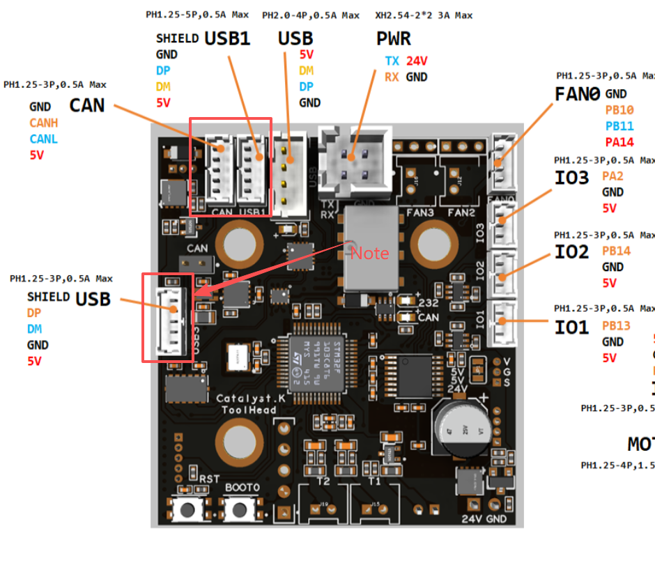
</p>

# Firmware compilation and upload
## Connection
A professional USB cable is included in the kit; connecting the Raspberry Pi to the Catalyst.KToolhead with it enables firmware uploading. Do not use other USB cables unless you have verified that their pinout matches that of the provided cable.
<p align="left">
  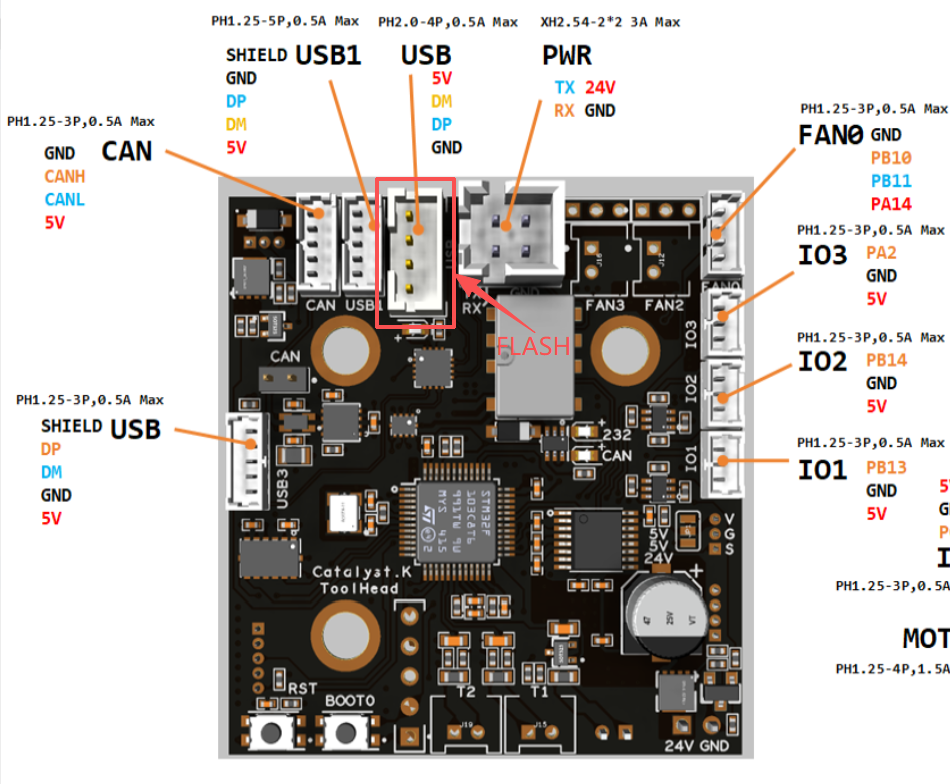
</p>

## Firmware Configuration
### General Klipper
#### Serial(Recommend)
<p align="left">
  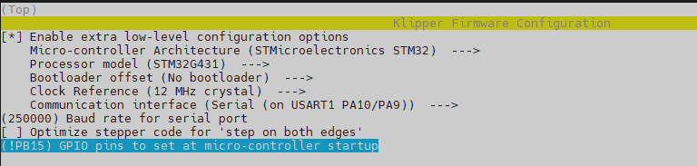
</p>

#### USB
<p align="left">
  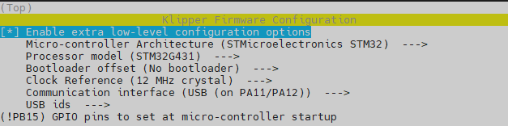
</p>

#### Can
<p align="left">
  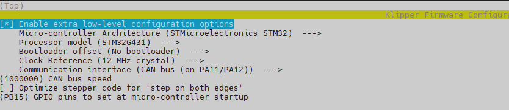
</p>


### K1_Series_Klipper
#### Serial(Recommend)
<p align="left">
  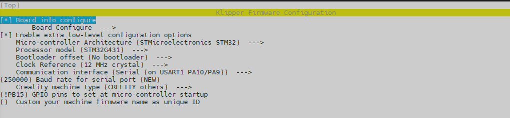
</p>

<p align="left">
  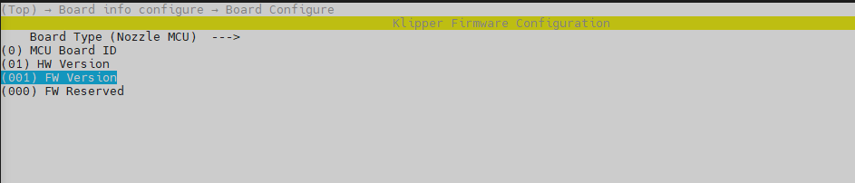
</p>


#### USB
<p align="left">
  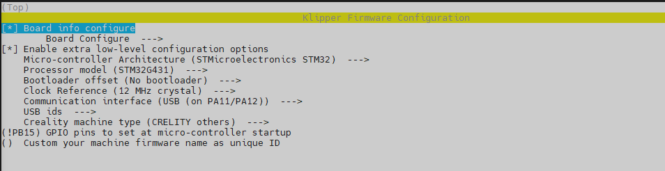
</p>

<p align="left">
  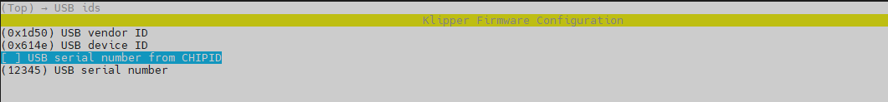
</p>

#### Can
<p align="left">
  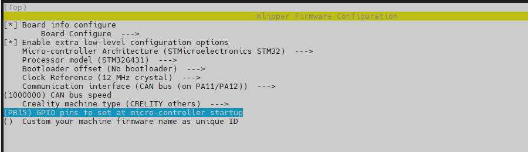
</p>

## Firmware Upload
Use the following commands to compile and upload the firmware.
```
cd ~/klipper # or cd ~/K1_Series_Klipper
make flash FLASH_DEVICE=0483:df11
```

## LED Indications
<p align="left">
  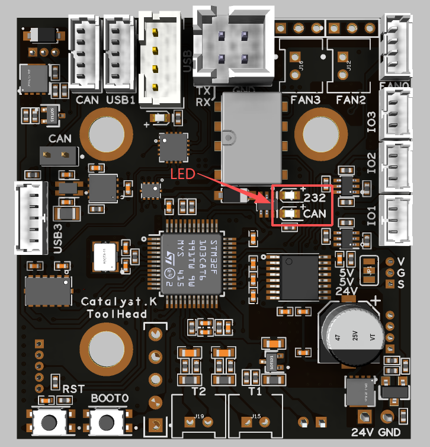
</p>

When in DFU mode, or after flashing firmware for USB/Serial mode, the green led turns on; after flashing firmware for CAN mode, the red led turns on.

# PinOut
<p align="left">
  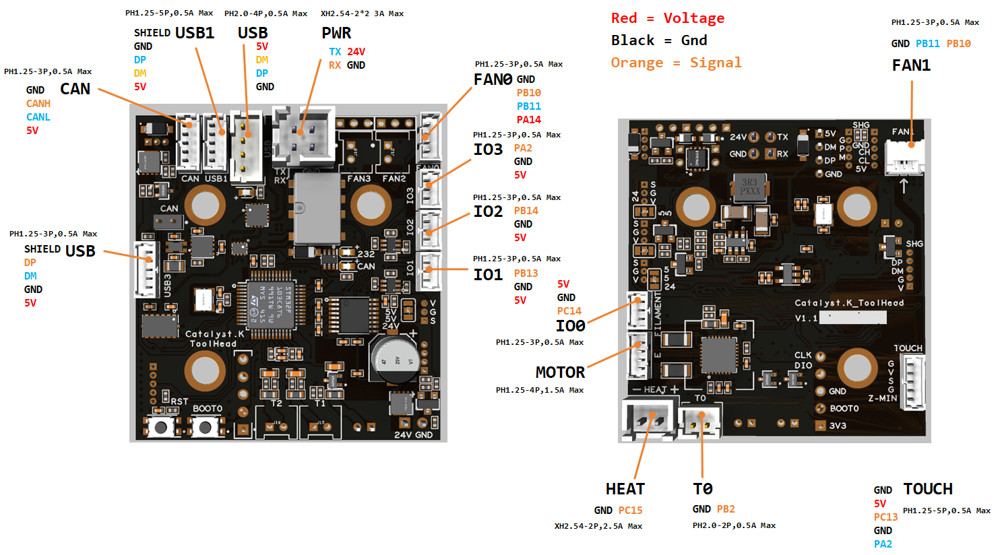
</p>

All peripherals are installed in the same positions as on the original board. With the exception of the shared serial and serial interfaces, the pinout definitions for all other terminals are identical to those of the original motherboard.

# Reference
[Catalyst.K-Tool](https://wiki.fysetc.com/docs/kpMZz8lV?preview=1)

# Product Link