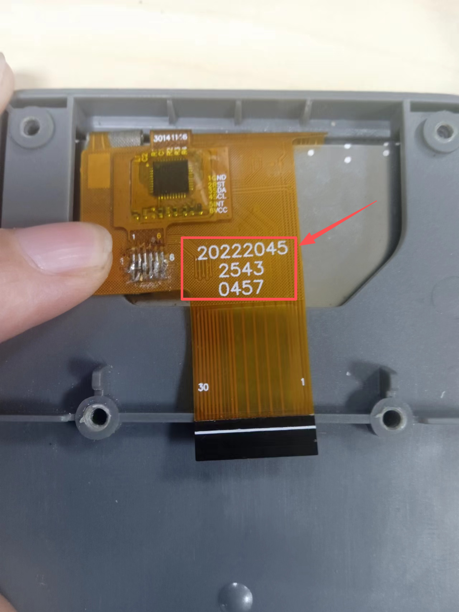

# Catalyst.K-mLCD

  

# Introduction
Catalyst.K is a video signal conversion board compatible with the original display screens of the Creality K1 series printers. It also supports touchscreen input.

# Features 
- Video driver Controller: LT6911C
- Touch driver Controller: CH32X035G8U6
- Communication Interface: Standard 4-wire USB interface (touch) and HDMI FPC ribbon cable
- Applications: original display screens of the Creality K1 series printers be used as a display for the Raspberry Pi.

# Applications 
- HDMI Signal Conversion: Powered by LT6911C chips to convert HDMI to RGB/MIPI video signals.
- Touch Control: Equipped with CH32X035G8U6 chips to drive touchscreen interfaces.

# Operating Conditions
This kit is compatible with certain Creality K1 series models, provided that the factory-installed LCD meets all of the following conditions simultaneously:
- The PCB on the back indicates that the LCD type is MIPI LCD.

  

- The LCD's FPC is yellow and bears the "20222045-2543-0457" label.

  

- The FPC cable specifies a 30-pin signal configuration

  

# Product Link