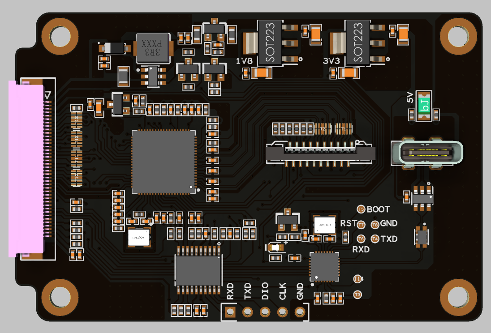
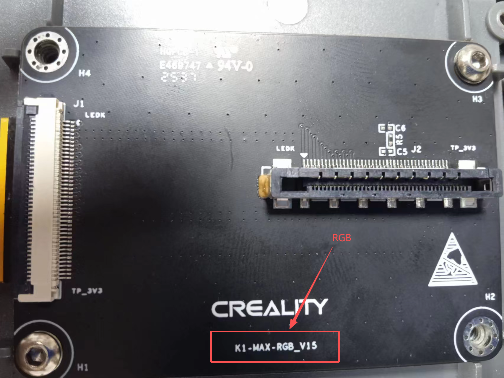
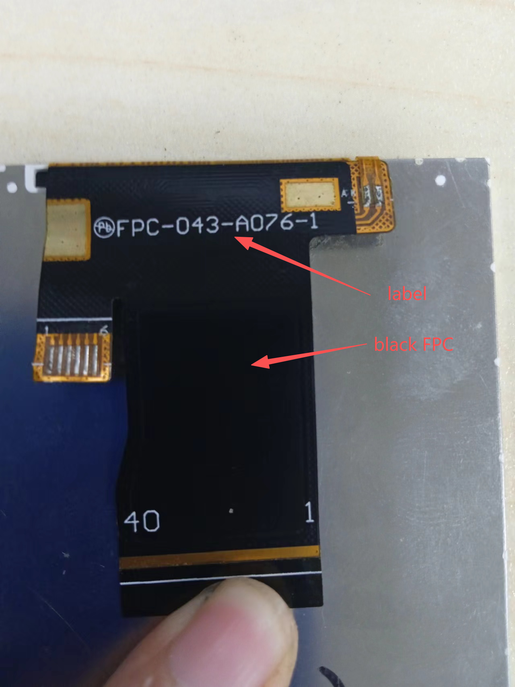
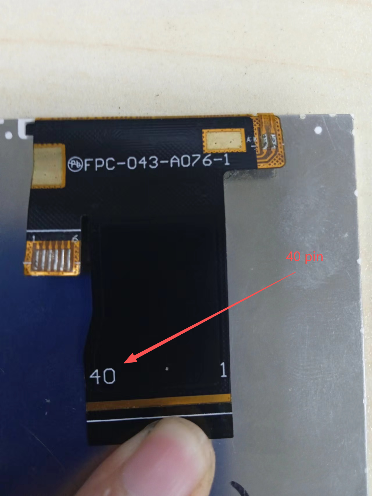
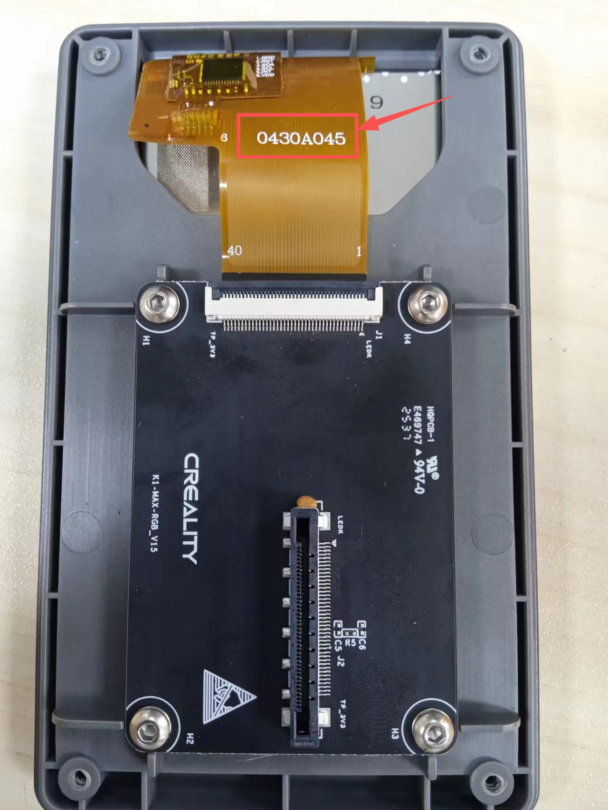
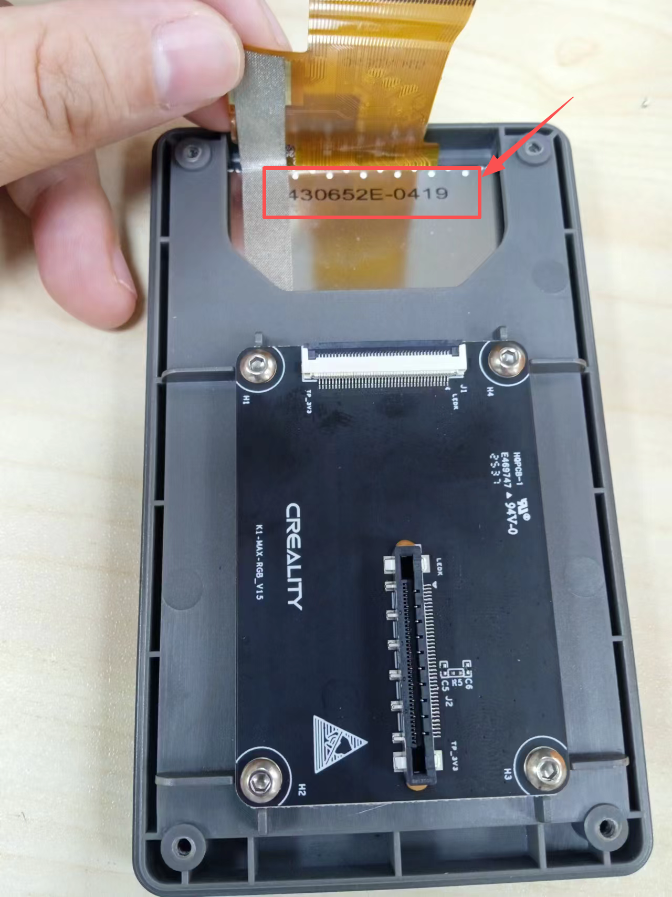

# Catalyst.K-rLCD

# Introduction
Catalyst.K-rLCD is a video signal conversion board compatible with the original display screens of the Creality K1 series printers. It also supports touchscreen input.

# Features 
- Video driver Controller: LT8619C
- Touch driver Controller: CH571F
- Communication Interface: Standard 4-wire USB interface (touch) and HDMI FPC ribbon cable

# Applications 
- HDMI Signal Conversion: Powered by LT6911C chips to convert HDMI to RGB/MIPI video signals.
- Touch Control: Equipped with CH32X035G8U6 chips to drive touchscreen interfaces.

# Operating Conditions
This kit is compatible with certain Creality K1 series models, provided that the factory-installed LCD meets all of the following conditions simultaneously:
- The PCB on the back indicates that the LCD type is RGB LCD.

  

- The LCD's FPC is black and bears the "FPC-043-A076-1" label.

  

- The FPC cable specifies a 40-pin signal configuration

  

The following are the LCDs that have been found to be unsupported.

  

  

The following are the LCDs that have been found to be unsupported.

  

  

# Product Link