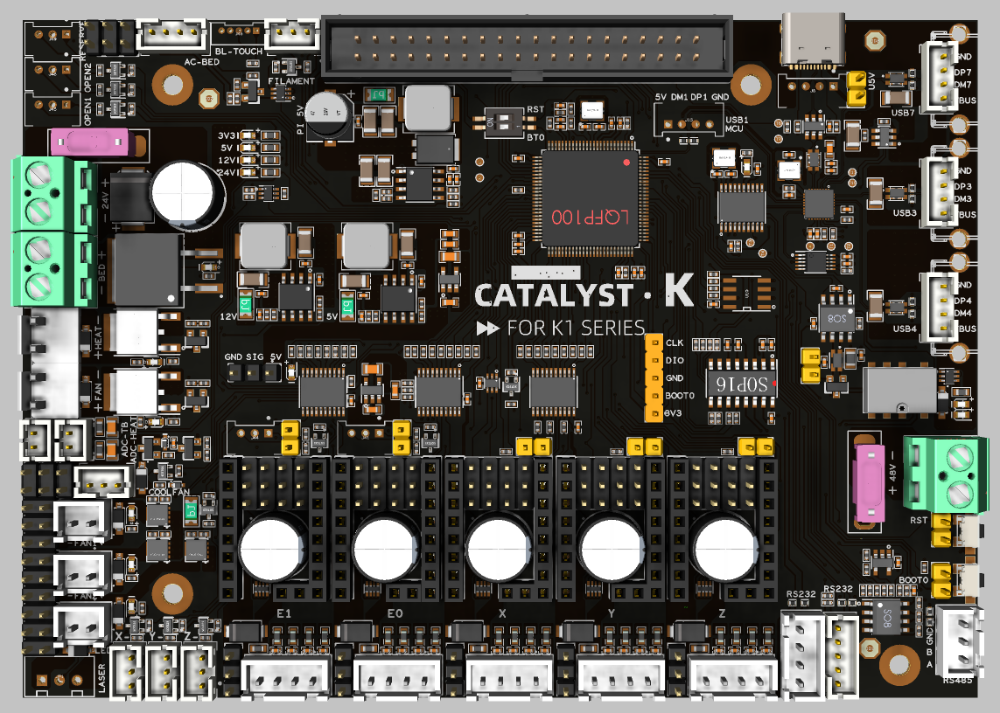
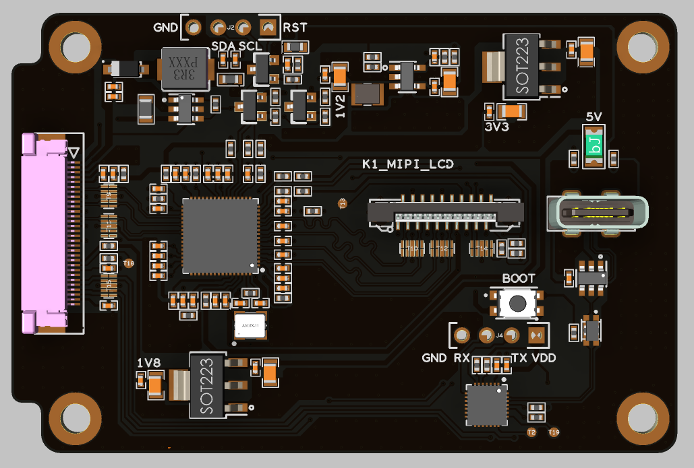
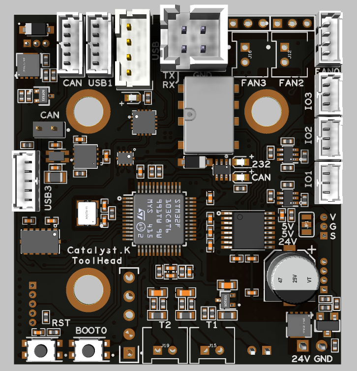
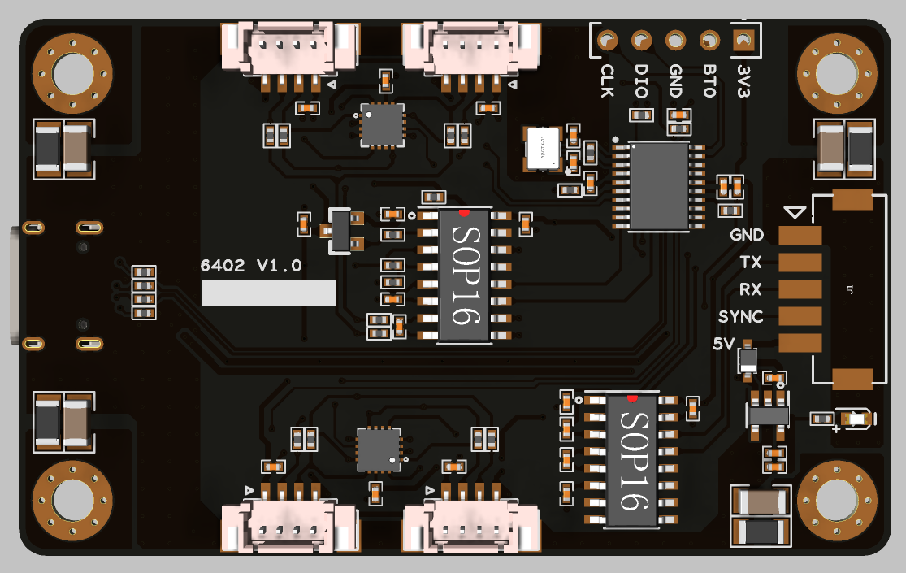
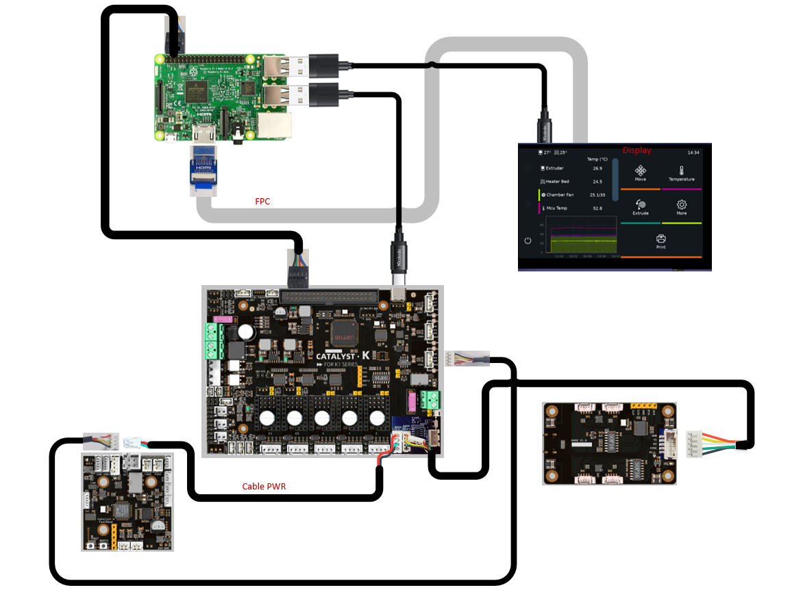
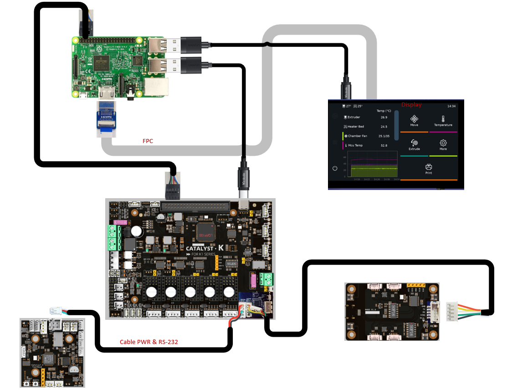
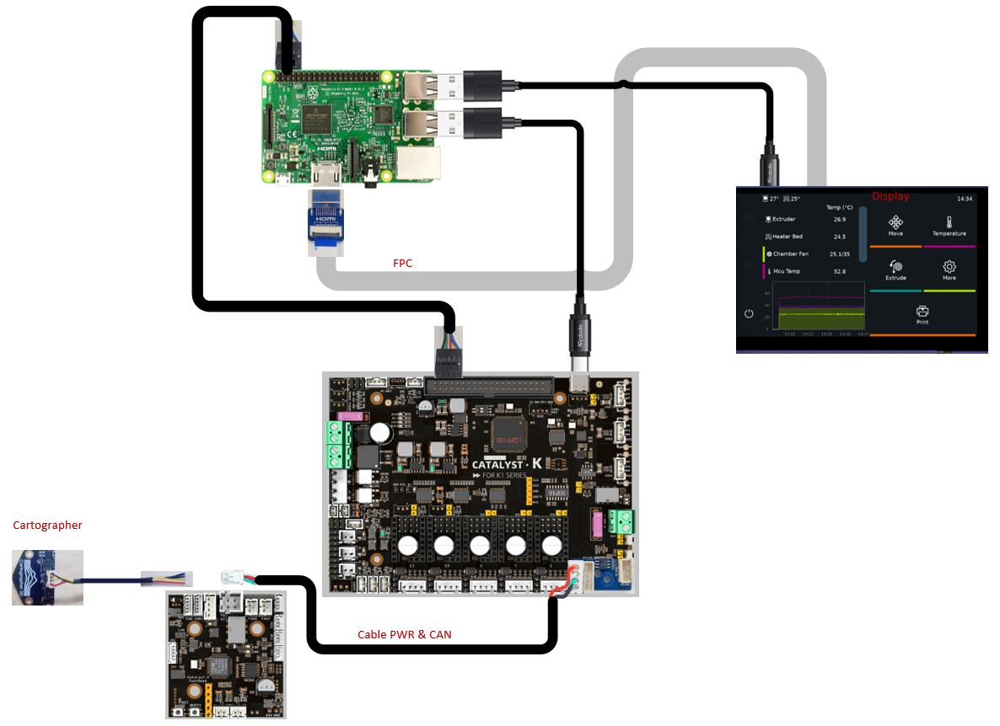

# Catalyst.K_Kit
different kits are provided, depending on the LCD. It is very important to confirm the type of LCD on your machine before making a purchase.
## Bill of Materials
### RGB LCD kit (tmc2209)
| Index | Sort                | Component    | Qty   |
| ----- | ------------------- | ------------ | ----- |
| 1     | Catalyst.K-Mainboard|Catalyst.K Mainboard x1(includes three TMC2209 driver modules) USB 2.0 to Type-C Data Cable (Angled Connector)x1 2.54mm Pitch 8-Pin Colorful Teflon Cable (with Terminals at Both Ends)x1 2.54mm Jumper Cap x5              | 1 SET |
| 2     | Catalyst.K-rLCD     |Catalyst.K-RGB Display Adapter Board x1 HDMI (standard) adapter board x1 HDMI (Micro) adapter board x1 USB 2.0 to Type-C Data Cable x1 0.5mm pitch 20-pin ribbon cable x1             | 1 SET |
| 3     | Catalyst.K-Tool     |Catalyst.K-Tool Board x1 USB 2.0 to 2mm-pitch 4-pin terminal data cable x1 2.mm Jumper Cap X5 2mm-high PCB standoff spacers (copper) x3 5mm-high PCB standoff spacers (copper) x3              | 1 SET |
| 4     | Catalyst.K-Level    |Catalyst.K Leveling Adapter Plate x1              | 1 SET |

### RGB LCD kit (tmc5160)
| Index | Sort                | Component    | Qty   |
| ----- | ------------------- | ------------ | ----- |
| 1     | Catalyst.K-Mainboard|(Includes two QHV5160 driver modules and one TMC2209 driver module) USB 2.0 to Type-C Data Cable (Angled Connector)x1 2.54mm Pitch 8-Pin Colorful Teflon Cable (with Terminals at Both Ends)x1 2.54mm Jumper Cap x5              | 1 SET |
| 2     | Catalyst.K-rLCD     |Catalyst.K-RGB Display Adapter Board x1 HDMI (standard) adapter board x1 HDMI (Micro) adapter board x1 USB 2.0 to Type-C Data Cable x1 0.5mm pitch 20-pin ribbon cable x1              | 1 SET |
| 3     | Catalyst.K-Tool     |Catalyst.K-Tool Board x1 USB 2.0 to 2mm-pitch 4-pin terminal data cable x1 2mm Jumper Cap X5 2mm-high PCB standoff spacers (copper) x3 5mm-high PCB standoff spacers (copper) x3              | 1 SET |
| 4     | Catalyst.K-Level    |Catalyst.K Leveling Adapter Plate x1              | 1 SET |

### MIPI LCD kit (tmc2209)
| Index | Sort                | Component    | Qty   |
| ----- | ------------------- | ------------ | ----- |
| 1     | Catalyst.K-Mainboard|Catalyst.K Mainboard x1(includes three TMC2209 driver modules) USB 2.0 to Type-C Data Cable (Angled Connector)x1 2.54mm Pitch 8-Pin Colorful Teflon Cable (with Terminals at Both Ends)x1 2.54mm Jumper Cap x5              | 1 SET |
| 2     | Catalyst.K-mLCD     |              | 1 SET |
| 3     | Catalyst.K-Tool     |Catalyst.K-Tool Board x1 USB 2.0 to 2mm-pitch 4-pin terminal data cable x1，2.mm Jumper Cap X5 2mm-high PCB standoff spacers (copper) x3, 5mm-high PCB standoff spacers (copper) x3              | 1 SET |
| 4     | Catalyst.K-Level    |Catalyst.K Leveling Adapter Plate              | 1 SET |

### MIPI LCD kit (tmc5160)
| Index | Sort                | Component    | Qty   |
| ----- | ------------------- | ------------ | ----- |
| 1     | Catalyst.K-Mainboard|Catalyst.K-Mainboard x1(Includes two QHV5160 driver modules and one TMC2209 driver module) USB 2.0 to Type-C Data Cable (Angled Connector)x1 2.54mm Pitch 8-Pin Colorful Teflon Cable (with Terminals at Both Ends)x1 2.54mm Jumper Cap x5              | 1 SET |
| 2     | Catalyst.K-mLCD     |              | 1 SET |
| 3     | Catalyst.K-Tool     |Catalyst.K-Tool Board x1 USB 2.0 to 2mm-pitch 4-pin terminal data cable x1 2.mm Jumper Cap X5 2mm-high PCB standoff spacers (copper) x3 5mm-high PCB standoff spacers (copper) x3              | 1 SET |
| 4     | Catalyst.K-Level    |Catalyst.K Leveling Adapter Plate              | 1 SET |

## Important Note
- The kit contents do not include the tool board connection cable, the Cartographer (probe), and the touchscreen.
- for tool board connection cable and touchscreen, you must use the original accessories provided with the device.
- Individual components from this kit cannot be used as direct replacements for official parts; the entire set must be replaced.

## Introduction
### Catalyst.K-Mainboard

- High‑performance MCU based on STM32H723 for demanding 3D printing workloads such as high‑speed interpolation and synchronized multi‑axis motion control.
- Native support for Klipper‑style setups via USB connection to Raspberry Pi 3B+/4B/5B or any Klipper‑compatible host.
- Five STEPSTICK sockets supporting flexible driver choices such as TMC5160 and TMC2209 to balance torque, smoothness, and silent operation.
- Selectable 24V/48V stepper motor supply with per‑motor voltage selection for mixed‑voltage motion systems.
- DC 24V input with 24V/10 A heated bed output, AC bed control signal output, and up to 5A hotend heater output for high‑power applications.
- On‑board regulated rails: 12V/3A, 5V/3A, 5V/6A (for Raspberry Pi power), and 3.3V/800 mA to power fans, sensors, and SBCs from a single board.
- Rich connectivity including 3× USB, 2× RS‑232, 1× RS‑485, and 1× high‑speed CAN interface for advanced expansions and distributed motion systems.
- Nine general‑purpose IOs and five fan outputs, with four voltage‑selectable (5V/12V/24V), plus an RGB header for status indication and lighting effects.

### Catalyst.K-rLCD

- Video driver Controller: LT8619C
- Touch driver Controller: CH571F
- Communication Interface: Standard 4-wire USB interface (touch) and HDMI FPC ribbon cable

### Catalyst.K-mLCD

- Video driver Controller: LT6911C
- Touch driver Controller: CH32X035G8U6
- Communication Interface: Standard 4-wire USB interface (touch) and HDMI FPC ribbon cable

### Catalyst.K-Tool

- Compact toolboard design: 47 mm × 44 mm, mounted directly near the printhead or extruder to greatly simplify wiring.
- STM32G431 MCU: 32‑bit high‑performance controller optimized for Klipper multi‑MCU setups.
- Multiple communication modes: Supports USB, CAN, and RS‑232, switchable via on‑board button.
- On‑board USB hub: Provides 3× USB ports and 1× CAN port for easy host and expansion connectivity.
- Integrated TMC2209: On‑board 24V‑powered TMC2209 stepper driver for silent, precise extruder control.
- Built‑in ADXL345: On‑board 3‑axis accelerometer for Klipper input shaping and resonance testing.
- Stable power outputs: 24V input (max. 28V) with on‑board 5V@3A and 3.3V@0.8A rails.
- Rich IO and fan interfaces: 4 level‑shifted IO pins, 4 fan outputs (2×2‑wire with selectable 5V/24V, 1×3‑wire, 1×4‑wire).
- Complete sensing and actuator interfaces: 3 temperature inputs, 1 BL‑Touch connector, 1 hotend heater output up to 2.5A.
- Easy debugging: On‑board BOOT0 and RESET buttons for quick flashing and debugging.

### Catalyst.K-Level

## Introduction
- Main Controller: STM32F042F6P6 (High-performance ARM Cortex-M0 32-bit microcontroller)
- Weighing/Data Acquisition Chip: HX711 (24-bit high-precision A/D converter with built-in voltage regulator)
- Communication Interface: RS-232 standard serial communication
- System Compatibility: Full support for Klipper open-source firmware

# Communication Methods
- USB(Recommend)

- RS-232(Recommend)

- CAN

For detailed wiring instructions, please refer to the GitHub repository:
- Raspberry Pi Power Wiring: https://github.com/FYSETC/Catalyst.K_Kit/tree/main/V1.1/Raspberry%20Pi/Wiring
- Display Wiring: https://github.com/FYSETC/Catalyst.K_Kit/tree/main/V1.1/Catalyst.K%20Screen/Wiring

# Reference
[Catalyst.K](https://wiki.fysetc.com/docs/JRDhzc53?preview=1)

[Catalyst.K ToolHead](https://wiki.fysetc.com/docs/kpMZz8lV?preview=1)

# Product Link

